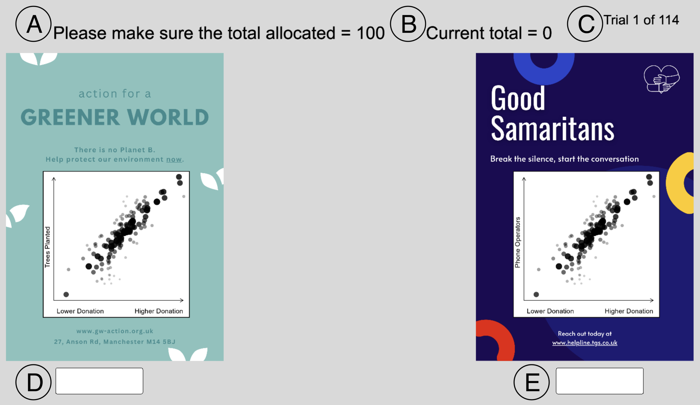

---
format:
  acm-pdf:
    include-in-header:
      text: |
        \usepackage{tcolorbox}
# use keep-tex to cause quarto to generate a .tex file
# which you can eventually use with TAPS
keep-tex: true
params:
  eval_models: true
  
knitr:
  opts_chunk: 
    cache_comments: false
    crop: true
    
execute: 
  echo: false
  warning: false
  message: false
  include: false
bibliography: donation-behaviour.bib
title: Donation Behaviour in an Online Visualisation Experiment
# if short-title is defined, then it's used
# short-title: 
author:
  - name: Gabriel Strain
    email: gabriel.strain@manchester.ac.uk
    orcid: 0000-0002-4769-9221
    affiliation:
      name: Department of Computer Science, Faculty of Science and Engineering, University of Manchester
      address: Oxford Road
      city: Manchester
      country: United Kingdom
      postal-code: M13 9PL
  - name: Aaditya Mehrotra
    email: aadityaa.mehrotra@manchester.ac.uk
    orcid: XX
    affiliation:
      name: Department of Computer Science, Faculty of Science and Engineering, University of Manchester
      address: Oxford Road
      city: Manchester
      country: United Kingdom
      postal-code: M13 9PL
  - name: Caroline Jay
    affiliation:
      name: Department of Computer Science, Faculty of Science and Engineering, University of Manchester
      address: Oxford Road
      city: Manchester
      country: United Kingdom
      postal-code: M13 9PL
  - name: Paul A. Warren
    email: paul.warren@manchester.ac.uk
    affiliation:
      name: Division of Psychology, Communication and Human Neuroscience, School of Health Sciences, Faculty of Biology, Medicine, and Health, University of Manchester
      address: Oxford Road
      city: Manchester
      country: United Kingdom
      postal-code: M13 9PL
  - name: Andrew J. Stewart
    email: andrew.j.stewart@manchester.ac.uk
    affiliation:
      name: Department of Computer Science, Faculty of Science and Engineering, University of Manchester
      address: Oxford Road
      city: Manchester
      country: United Kingdom
      postal-code: M13 9PL

# acm-specific metadata
acm-metadata:
  # comment this out to make submission anonymous
  anonymous: false
  # comment this out to build a draft version
  final: true
  # comment this out to specify detailed document options
  acmart-options: sigconf
  # acm preamble information
  copyright-year: 2027
  acm-year: 2027
  copyright: cc
  doi: 10.1145/3706598.3713809
  conference-acronym: "CHI'27"
  conference-name: CHI Conference on Human Factors in Computing Systems
    
  conference-date: April 26-May 1, 2027
  conference-location: Pittsburgh, USA
  isbn: 
  # if present, replaces the list of authors in the page header.
  shortauthors: Strain et al.
  # The code below is generated by the tool at http://dl.acm.org/ccs.cfm.
  # Please copy and paste the code instead of the example below.
  ccs: |
    \begin{CCSXML}
    <ccs2012>
     <concept>
      <concept_id>10003120.10003145</concept_id>
      <concept_desc>Human-centered computing~Visualization</concept_desc>
      <concept_significance>500</concept_significance>
     </concept>
     <concept>
      <concept_id>10003120.10003145.10011769</concept_id>
      <concept_desc>Human-centered computing~Empirical studies in visualization</concept_desc>
      <concept_significance>500</concept_significance>
     </concept>
     <concept>
      <concept_id>10003120.10003145.10011770</concept_id>
      <concept_desc>Human-centered computing~Visualization design and evaluation methods</concept_desc>
      <concept_significance>300</concept_significance>
     </concept>
     <concept>
      <concept_id>10003120.10003121.10011748</concept_id
      <concept_desc>Human-centered computing~Empirical studies in HCI</concept_desc>
      <concept_significance>500</concept_significance>
     </concept>
    </ccs2012>
    \end{CCSXML}
    
    \ccsdesc[500]{Human-centered computing~Visualization}
    \ccsdesc[500]{Human-centered computing~Empirical studies in visualization}
    \ccsdesc[300]{Human-centered computing~Visualization design and evaluation methods}
    \ccsdesc[500]{Human-centered computing~Empirical studies in HCI}
  keywords:
    - donation behaviour
    - scatterplot
    - crowdsourced
  
abstract: |
  abstract goes here.
---

```{r}
#| label: setup

# load in libraries

library(tidyverse)
library(MASS)
library(emmeans)
library(scales)
library(buildmer)
library(lme4)
library(kableExtra)
library(papaja)
library(qwraps2)
library(lmerTest)
library(ggdist)
library(ggpubr)
library(conflicted)
library(ggtext)
library(Matrix)
library(ordinal)
library(janitor)

# fix conflicts now using the conflicted package

conflicts_prefer(dplyr::select(), dplyr::filter(), lme4::lmer())
options(knitr.kable.NA = "")
```

```{r}
#| label: lazyload-cache
if (!params$eval_models){ lazyload_cache_dir("donation_behaviour_cache/pdf") }
```

```{r}
#| label: load-data
# load in data csv for main experiment, remove the "__participant" column now 

anon_file <- read_csv("data/exp_data_final.csv", guess_max = 17000) # we need a higher guess_max for read_csv to correctly interpret column data types
```

```{r}
#| label: wrangle-data
## NB: With the exception of anonymization, data are provided as-is from 
## pavlovia (survey tool). Wrangling functions *must* be run first to make
## the data sets usable

# extract demographic information

wrangle <- function(anon_file) {
  
demographics <- anon_file %>%
  filter(!is.na(age_textbox.text)) %>%
  select(matches(c("participant",
                   "age_textbox.text",
                   "gender_slider.response")))

# extract time taken information

time_taken <- anon_file %>%
  filter(!is.na(final.stopped)) %>%
  select(c("participant", "final.stopped"))

# extract charity Likert ratings

charity_opinions <- anon_file %>%
  select(c("participant",
           "c1_slider.response",
           "c2_slider.response",
           "c3_slider.response")) %>%
  filter(!is.na(c1_slider.response)) %>%
  rename("dog_rescue_likert"  = "c1_slider.response",
         "environment_likert" = "c2_slider.response",
         "helpline_likert"    = "c3_slider.response")

# extract charity rankings

charity_rankings <- anon_file %>%
  select(c("participant",
           "donation_behaviour_survey.block_1/question1")) %>%
  rename("ranking" = "donation_behaviour_survey.block_1/question1") %>%
  filter(!is.na(ranking)) %>%
    mutate(
    ranking_list = ranking %>%
      str_remove_all('\\[|\\]|"') %>%
      str_squish() %>%
      str_split(",\\s*"),
    dog_rescue_rank  = map_int(ranking_list, ~ which(.x == "Item 1")),
    helpline_rank    = map_int(ranking_list, ~ which(.x == "Item 2")),
    environment_rank = map_int(ranking_list, ~ which(.x == "Item 3"))
  ) %>%
  select(-c("ranking", "ranking_list"))
  
# get main experiment data, join other dataframes

anon_file %>%
  select(c("participant",
           "trial_id",
           "left_charity",
           "right_charity",
           "left_plot_type",
           "right_plot_type",
           "left_correlation",
           "right_correlation",
           "same_plot_type",
           "same_correlation",
           "tb1.text",
           "tb3.text",
          # "passed"
           )) %>%
  rename("left_amount"  = "tb1.text",
         "right_amount" = "tb3.text") %>%
  mutate(
    left_amount = as.numeric(gsub("[^0-9.-]", "", left_amount)),
    right_amount = as.numeric(gsub("[^0-9.-]", "", right_amount))) %>%
  mutate(across(c(left_amount, right_amount), ~replace_na(., 0))) %>%
  filter(trial_id < 109) %>%
  full_join(demographics,     by = "participant") %>%
  full_join(time_taken,       by = "participant") %>%
  full_join(charity_opinions, by = "participant") %>%
  full_join(charity_rankings, by = "participant") %>%
  mutate(
    left_plot_type  = factor(left_plot_type,  levels = c("Norm", "Alt")),
    right_plot_type = factor(right_plot_type, levels = c("Norm", "Alt")),
    left_correlation  = factor(left_correlation,  levels = 1:3, ordered = TRUE),
    right_correlation = factor(right_correlation, levels = 1:3, ordered = TRUE)) %>%
    pivot_longer(
    cols = c(left_charity,  right_charity,
             left_plot_type, right_plot_type,
             left_correlation, right_correlation,
             left_amount,  right_amount),
    names_to      = c("side", ".value"),
    names_pattern = "(left|right)_(.*)"
  ) %>%
  mutate(charity = factor(charity),
         side    = factor(side, levels = c("left", "right"))) %>%
  left_join(
    anon_file %>%
      full_join(charity_opinions, by = "participant") %>%
      full_join(charity_rankings, by = "participant") %>%
      select(participant,
             dog_rescue_likert, environment_likert, helpline_likert,
             dog_rescue_rank,   environment_rank,   helpline_rank) %>%
      distinct() %>%
      pivot_longer(
        cols          = -participant,
        names_to      = c("charity_key", ".value"),
        names_pattern = "(.+)_(likert|rank)"
      ) %>%
      mutate(
        charity = factor(recode(charity_key,
                                dog_rescue  = "dog_rescue",
                                environment = "greener_world",
                                helpline    = "samaritans"))
      ) %>%
      select(participant, charity, likert, rank),
    by = c("participant", "charity")
  ) %>%
    mutate(
    likert = factor(likert, levels = 1:7, ordered = TRUE),
    rank   = factor(rank,   levels = 1:3, ordered = TRUE),
    correlation_num = as.numeric(as.character(correlation))
  ) %>%
  assign(paste0(unique(anon_file$expName), "_tidy"),
           value = ., envir = .GlobalEnv)
}

wrangle(anon_file)

# extract demographics and time taken info for rendering in text

gender <- distinct(donation_behaviour_tidy, participant,
                   .keep_all = TRUE) %>%
  group_by(gender_slider.response) %>%
  summarise(sum = n()) %>%
  pivot_wider(names_from = gender_slider.response,
              values_from = sum) %>%
  clean_names()

age <- distinct(donation_behaviour_tidy, participant,
                .keep_all = TRUE) %>%
  summarise(mean = mean(age_textbox.text, na.rm = TRUE),
            sd = sd(age_textbox.text, na.rm = TRUE))

time_taken <- distinct(donation_behaviour_tidy, participant,
                .keep_all = TRUE) %>%
  summarise(mean = mean(final.stopped/60, na.rm = TRUE),
            sd = sd(final.stopped/60, na.rm = TRUE))
```

# Introduction {#sec-intro}

 - some justification for only using scatterplots
 - motivate the study of data visualisation and behaviour change
 - motivate the use of novel visualisation techniques
 - 

# Related Work {#sec-related-work}

## Donation Behaviour {#sec-donation-behaviour}

 - factors influencing charitable donations
 - specifically regarding online infographics/donation campaigns
 - do people donate more to things they like more?
 - do they donate more to things that show better outcomes?

## Behaviour and Data Visualisation {#sec-behaviour-data-viz}

 - how can data visualisation change people's behaviours?
 - the persuasive power of data visualisation and how can this extend to driving behaviour change
 - data visualisation and belief change
 - then, can this meaningfully be extended to modify behaviour?

## Correlation Perception & Modified Scatterplots {#sec-corr-percept}

 - factors influencing correlation perception, including what we have found
 - how have scatterplots been modified to induce changes in correlation perception
 - then, how this has been shown to extend to belief change
 - motivate the study of behaviour change as a result of visualisation viewing
 - particularly, highlight the potential moral benefit of motivating better behaviour
 
## Using Visualisation Techniques to Drive Behaviour Modification

 - has anything like this been tested before? (I am assuming not)
 - hat are the potential implications of this?

# Hypotheses {#sec-hypotheses}

We formulate the first hypothesis based on previous evidence that people will donate
more money to charitable concerns that they prefer:

 - H~1~: participants will donate more money to charities that they prefer, as tested by Likert scales and a charity ranking.
 
Owing to evidence that strong relationships portrayed in scatterplots can induce
belief change in viewers, and that, featured in data visualisations can have 
effects on viewers' thoughts and attitudes, we formulate the second hypothesis:

 - H~2~: participants will donate more money to charities whose infographics feature scatterplots with higher *r* values.
 
Finally, in light of evidence that scatterplots whose points have been modified in
such a way that correlation is perceived as higher and is able to induce belief
change to a greater degree, we formulate the third hypothesis. This hypothesis
is non-directional due to small effects sizes reported in a previous study
that utilised these techniques:

 - H~3~: participants' donation amounts will be affected (non-directionally) by the type (standard or alternative) of scatterplot displayed.

# Methodology {#sec-methods}

In this section we begin by discussing our research methods, including the open 
and reproducible research practices we used and the modelling paradigms utilised in
our analyses. We then detail the design of our stimuli, the design of the experiment,
the experimental procedure, and participant recruitment and characteristics.

## Open Research {#sec-open-research}

The experiment was conducted according the principles of open and reproducible
research [@ayris_2018]. Hypotheses and analysis plans were pre-registered with
the Open Science Framework (OSF)[^1]. All data and analysis code are included
in a GitHub repository[^2], which also contains instructions for building a 
Docker container [@merkel_2014] that reproduces the computational environment
in which the paper was written. By capturing package versions and dependencies
using the `renv` package [@ushey_2026] in R, this container allows for full replication
of all stimuli, figures, analyses, and the paper itself. Ethical approval
was granted by *removed for anon*.

[^1]: https://osf.io/kywt9/overview?view_only=1f677775eb80467dae61c7502bc3305f
[^2]: removed for anon

## Modelling {#sec-modelling}

## Stimuli {#sec-stimuli}

Three charitable concerns were chosen for the experiment. Initially, we intended 
to use the five charitable concerns outline in She and Sanfey, 2023 [@she_2023]. 
These were:

 1. Dog Rescue/Re-housing.
 2. Environmental Protection.
 3. Mental Health Helpline.
 4. Education in Disadvantaged Communities.
 5. Support for Homeless Individuals.
 
 Due to our inclusion of different correlations and scatterplot types, the use
 of five charity categories would have resulted in an unfeasibly large number of
 experimental trials. Concerns about participant fatigue and experimental length
 led us to use only the first three charity categories for the present experiment.
 After deciding on the three charity categories, one author created candidate
 fictional charities for each. Two authors then decided on a single fictional
 charity for each category. @tbl-candidate-charities shows the candidate charities
 for each charity category. The final chosen charity is highlighted in each case.
 
 
```{r}
#| label: tbl-candidate-charities
#| include: true
#| tbl-cap: placeholder


```
 
 
 
 

## Design {#sec-design}

We employed a fully within-subjects design. With 18 unique plots (3 charities
$\times$ 3 correlation values $\times$ 2 plot types), all unique combinations would
result in $\binom{18}{2} = 153$ pairs. To decrease the task load on participants, we
removed the 45 trials which featured the same charity for a final total of 108
experimental trials. Participants viewed all 108 experimental trials along with
6 attention check trials, in a fully-randomised order. Our dependent variable was
the amount of money participants assigned to the left and right charity infographics
on a per-trial basis. The experiment, including all stimuli, materials, and 
instructions, are hosted on GitLab [1^].

[1^]: removed for anon.

## Procedure {#sec-procedure}

The experiment was built using PsychoPy [@pierce_2019] and is hosted on Pavlovia.org.
Participants were instructed to only complete the experiment on desktop or laptop
computers. Each participants first viewed the participant information sheet and provided
consent by checking boxes next to consent statements. Consent was required in order
to progress through the experiment. They were asked to provide their age in a
free text box, followed by their gender identity. Using Likert scales, participants
were then asked to indicate how important the three chosen charitable concerns were
to them (Dog Rescue and Re-Housing, Environmental Protection, and Mental Health
Helpline). Each Likert scale featured seven points, and was anchored at points 1 
and 7 with "Not at all important" and "Extremely important". Participants then
used a drag-and-drop interface to rank the three charitable concerns. Following 
the pre-experimental tests, participants were then asked to complete eight rounds
of the Remote Associated Test (RAT), which acted as a filler task to prevent 
carryover effects [@she_2023]. Participants were given 15 seconds for each round
of the RAT, and were not required to answer. Participants were given instructions, 
including the following:

```{=latex}
\hspace{0pt}
\begin{tcolorbox}[colback=gray!10, colframe=gray!50, boxrule=0.5pt]
...
\newline
  5. We encourage you to make assignments as if it were your own money.
  \newline
  6. To help you get into this mindset, the research team have decided to donate money to real-life charities based on the totals donated by all participants over the course of the experiment.
  \newline
  7. Once the experiment has concluded, you will receive an email detailing how the research team have split the money and which charities have been donated to.
  \newline
  ...
\end{tcolorbox}
\hspace{0pt}
```

Participants were informed that this was a deception at the conclusion of the
experiment. Following instructions, the experiment began. In a series of 108 experimental
trials, participants were asked to split 100 dollars between two charity infographics.
Presentation order was randomised, including 6 attention check trials which
explicitly asked participants to assign 100 dollars to either the left (n = 3) or the
right (n = 3) charity infographic. An example of an experimental trial can be seen
in @fig-example-trial. After completing all trials, participants were debriefed
regarding the deception employed and thanked for their participation.

```{r}
#| label: fig-example-trial
#| fig-env: "figure*"
#| include: true
#| out-width: "100%"
#| fig-cap: "An example of an experimental trial. Illustrated are the reminder to use all available money (A), the display of the current total (B), the trial counter (C), the left infographic and allocation box (D), and the right infographic and allocation box (E)"


```

## Participants {#sec-participants}

Participants were recruited using Prolific [@prolific]. English fluency and normal
or corrected-to-normal vision were required, as well as having not previously taken
part in any of the research team's previous studies into scatterplot visualisations
(references withheld for anon). In an effort to improve data quality, strict 
pre-screening criteria were also employed [@peer_2021]; participants were required
to have previously completed at least 100 studies on the platform, and were 
required to have been accepted on at least 99% of them. Data were collected
from 174 participants. 10 failed more than 3 out of 6 attention checks, meaning their
submissions were rejected in accordance with our pre-registration [1^]. Data
from the remaining 164 participants were included in the full analysis 
(`r printnum(gender$male, digits = 2)` male, `r printnum(gender$female, digits = 2)`
female, and `r printnum(gender$non_binary, digits = 2)` non-binary).
Participants' mean age was `r printnum(age$mean, digits = 1)`
(SD = `r printnum(age$sd, digits = 1)`). Participants took a mean of 
`r printnum(time_taken$mean, digits = 1)` minutes to complete the 
experiment (SD = `r printnum(time_taken$sd)`).

[1^]: The pre-registration states that 150 participants would be recruited. Additional participants were recruited due to an oversight, however all conclusions and statistical results are identical when run with 164 or 150 participants.

# Results {#sec-results}


# Discussion {#sec-discussions}

# Conclusion {#sec-cocnlusion}

# References {.unnumbered}
